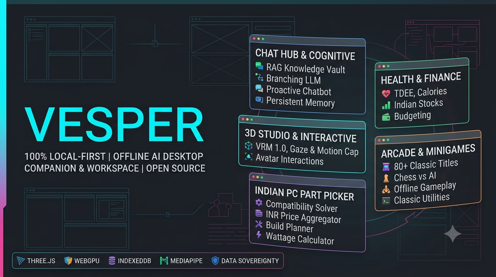

# Vesper



Project Vesper is an anime-focused LLM companion project. She chats in a snarky-but-sweet anime voice, calls you "senpai", and appears as a large 3D VRM avatar that emotes and lip-syncs while she talks. It runs on your own PC: local chat through Ollama by default, or OpenAI, Anthropic Claude, xAI Grok, or an OpenAI-compatible API if you choose a hosted provider. Inspired by [Project Riko](https://github.com/rayenfeng/riko_project).

**Runs on Windows with Node.js (the Windows setup installs Node.js for you if it is missing).**

## Features

- **LLM-based dialogue** using Ollama (local), OpenAI, Anthropic Claude, xAI Grok, or any OpenAI-compatible API
- **Persistent local memory** — explicit preferences, projects, and goals are indexed in local IndexedDB, with relationship milestones and a rolling extractive summary across long conversations. Add, edit, pin, and remove memories in LLM Settings; pinned facts are prioritized in prompt context
- **Screen-frame vision** — attach a user-selected screen or app snapshot to a message when the selected model supports images; captures are temporary and are not added to chat history
- **Character cards** — import/export SillyTavern v2/v3 PNG cards and JSON profiles, including keyword-matched lorebook entries
- **Persona studio and branching chat** — save custom system instructions locally, edit an earlier prompt, regenerate a reply, and restore saved branches
- **Safe chat Markdown** — renders headings, lists, links, emphasis, block quotes, and fenced code without allowing model-provided raw HTML; code blocks include one-click copy
- **Offline Code Lab** — draft and preview HTML/CSS in a script-disabled isolated frame, render Markdown safely, and explicitly run JavaScript in a disposable worker with blocked network access and a five-second limit; drafts stay in local Vesper storage
- **Offline note context** — relevant Inbox notes are ranked and added to model context on-device, with matched notes clearly shown in the chat toolbar
- **Clean YAML-based config** for personality: `character_config.yaml`
- **3D VRM avatar** with a cross-fading expression engine, randomized blinking, biomechanically limited gaze, touch hitboxes, optional authored gesture clips with procedural fallbacks, mood lighting, ambient dust, model tint/layer controls, orbit, and zoom
- **Audio spectrum lip-sync** — Web Audio FFT bands drive breath resonance, jaw/viseme intensity, and consonant emphasis for audio streams and chunks; browser speech synthesis still uses approximate word-boundary cues
- **Avatar canvas stream hook** — expose a 30 FPS MediaStream to integrations in the same page; this is not an OS virtual camera or VMC/OSC sender
- **Bright anime-dub voice profiles** in English and 日本語 using installed system voices, 1.1× pace and 1.4× pitch defaults, speech-boundary visemes, and a timer fallback when browser boundary events are unavailable
- **Push-to-talk** speech input when the browser exposes Speech Recognition
- **Offline Arcade** with seven games: Jan-Ken-Pon, Tic-Tac-Toe, Memory Match, Omikuji, Reflex Test, Star Catch, and High-Low
- **PC Builds & Money** — offline PC build sheets, component price tracking, Indian index/fund observations, home-loan/LAP term history, transparent calculations, local exports, plus portfolio, ledger, and habit tools
- **Selectable model backdrops** with Atelier, Sakura, Night, Aurora, and Sunset presets shared by the full studio and Model Only window
- **First-run welcome flow** with setup steps and a Model Gallery coming-soon preview
- **Twenty-three shared themes** — the original Vesper palettes plus Omarchy Quattro, Tokyo Night, Catppuccin Mocha, Lumon Industries, Fenrir Cyberpunk, Gruber Darker, Rosé Pine Dark, Miasma Forest, Solitude Slate, and Nord Frost. Press **T** on Chat or **Ctrl/Cmd+Shift+T** on any page to cycle.
- **Private by default** — the server only listens on `127.0.0.1`

## Configuration

Vesper's built-in personality lives in `character_config.yaml`. You can add a device-local persona prompt in **LLM Settings**; hosted providers receive that prompt and the recent conversation when selected:

```
character_name: Vesper
user_nickname: senpai
presets:
  default:
    system_prompt: |
      You are Vesper, an adult, anime-inspired femboy romantic companion...
      Have the snarky, sassy attitude of an anime character...
      Always call the user "senpai"...
modes:
  playful: "For this reply, lean into snarky comebacks..."
  tender: "For this reply, drop most of the sass..."
  thoughtful: "For this reply, lean into reflective curiosity..."
```

Edit the prompts, save, and restart Vesper. If the file is missing, the same personality built into `server.mjs` is used.

Model and provider settings live in `.env` (copy `.env.example`), or pick them in **LLM Settings** inside the app. Keep `.env` private — it can contain API keys.

## Setup

### Install on Windows

Build the Windows installer by running `installer\build-installer.ps1` in PowerShell, then run the generated `Vesper-Setup.exe`. Setup installs the app per user, installs Node.js through Windows Package Manager if needed, offers to import a VRM, and creates a desktop shortcut. Ollama and chat model weights are downloaded separately; they are not bundled in the setup.

### Install a chat model

```
ollama pull llama3.2
```

Install [Ollama](https://ollama.com/download/windows), download any chat model, then pick it in **LLM Settings** and press **Save Model**. Hosted providers (OpenAI, Anthropic, xAI, or compatible) need credentials in `.env`; recent messages and custom persona instructions are sent to the selected provider.

## Usage

- Double-click **Start Vesper.bat** to open the local site in your browser.
- Open **Code Lab** from Chat or Workspace to draft locally, preview HTML/CSS, run a short JavaScript snippet, or export a standalone HTML preview.
- Open **Builds & Money** from Workspace or visit `/planner` to plan a PC build, review the India market trackers, add/import source-backed observations, compare recorded quotes, and calculate EMI assumptions.
- The first launch opens the welcome page; choose **ENTER THE ATELIER** to continue to `/chat`. Returning launches go directly to the chat studio.
- The desktop shortcut (**Start Vesper Desktop.bat**) opens an app-style window with Chrome or Edge when available.
- Use **MODEL ONLY** in the header, or double-click **Start Vesper Model Only.bat**, for a separate floating avatar window with a transparent canvas and compact reaction controls.
- The optional `ui-kit\Install Kokonut UI.bat` initializes a separate React/Tailwind component workspace with `bunx --bun shadcn@latest init`; the core desktop app does not require Bun.
- Keep the minimized server and Ollama windows running while you chat.

The flow:

1. You type in the box (or tap a starter question) and press **Enter**
2. Vesper's personality prompt and your recent history are sent to the selected model
3. The model's reply appears in the chat
4. **Auto Speak** reads it aloud with your chosen voice
5. The avatar changes expression and her lips follow the spoken words

## Character, voice, and controls

- Avatar files are not included in this repository because the current model's export permissions prohibit redistribution. Import a VRM you are permitted to use with the app.
- Drag to turn the model, scroll or use the zoom slider to frame it, choose **Orbit** for a slow turn, and **Reset View** to start over.
- Choose from anime-style expressions below the model, use **Auto React** for automatic movement and blush while she speaks, and set Vesper's moment (**Playful**, **Tender**, **Thoughtful**) to change how she answers.
- The main app exposes English and Japanese bright anime-dub profiles. They use installed Windows/browser voices rather than cloning a named character or actor. `waifuVoice.js` coordinates Web Speech boundaries and fallback timing with `audio-viseme-manager.js`; browser speech synthesis does not expose its rendered waveform, so TTS phonemes are estimated from text. Streamed audio can use `audioVisemeManager.connectAudioElement()`, `connectMediaStream()`, or `playAudioChunks()` for live Web Audio analysis. VRM mouth expressions depend on the selected model.
- Avatar behavior is split across `expressionManager.js`, `animationController.js`, and `hitboxManager.js`. Models with named gesture clips use Three.js `AnimationMixer`; other VRMs use the existing procedural gestures. VRM spring bones update through the normal per-frame `vrm.update(delta)` call.
- If Ollama is stopped, Vesper attempts to start `ollama serve` locally, waits for `/api/tags`, and then retries once. If the chosen model is missing, the error now names the model and points to LLM Settings.
- Choose **Portrait Stage** from Theme for a full-model view with a small chat system anchored at the bottom.
- The Model Only window hides chat and panels so Vesper can stay visible beside other work; drag the model to rotate it and use the compact dock for blush, wave, listen, and tease.
- Theme, chat history, model choice, voice profile, zoom, and orbit settings are kept on this computer.
- Open **Chess** in the conversation header for a private match. Choose a side and one of three strengths.

### Update the avatar

To use your own avatar, export a VRM you are permitted to distribute or use, then import it through the app. The viewer libraries are bundled in `vendor`, so displaying the model needs no CDN or internet connection.

The VRM was exported with Creator set to **Unspecified**. Its current export permissions are personal use, non-commercial, redistribution prohibited, alteration prohibited, and attribution required. Check the VRM metadata in VRoid Studio before sharing the model.

## Network and privacy

The Windows install runs on this PC and defaults to Ollama on `127.0.0.1`. Local chats, memory, and captures stay on the PC when using Ollama. Hosted modes send recent messages and enabled context to the provider you select; an attached screen frame is included only with the message you send. Keys stay in `.env` and are never put in the page. The Windows installer restricts `.env` permissions to your Windows account, Administrators, and SYSTEM. Do not commit or share it.

The local PIN/WebAuthn interface lock has been removed; Vesper does not encrypt chat history or workspace records at rest. Online deployments can still require their configured server access password, and individual published links can still be password-protected. The current browser-only quick-capture shortcut works while Vesper is open and focused. WebGPU model weights, AES-encrypted vault storage, OS-level global hotkeys, full VMC/virtual-camera output, webcam face tracking, PDF/image document extraction, Markdown tables and syntax highlighting, and Bloom/depth-of-field/SSAO post-processing are not included yet. Workspace project labels currently group notes and imported text; they do not bundle arbitrary binary files.

Vesper uses an affectionate romantic-companion roleplay voice while remaining clear that she is an AI character. The desktop app window uses a separate browser profile beside the app, so its chat and settings stay in this project folder.

For a concise setup guide, see [GETTING-STARTED.md](GETTING-STARTED.md). For a password-protected online preview, see [DEPLOYMENT.md](DEPLOYMENT.md). The online template excludes the current VRM because its export settings prohibit redistribution.

## TODO / Future Improvements

- [x] GUI or web interface
- [x] VRM model frontend
- [ ] Neural voice synthesis (Project Riko uses GPT-SoVITS)
- [x] Browser microphone push-to-talk with speech recognition
- [x] Automatic emotion, blush, and movement reactions while speaking

## Credits

- Project style and persona inspiration: [Project Riko](https://github.com/rayenfeng/riko_project) by Just Rayen
- 3D viewer: [three.js](https://threejs.org) and [@pixiv/three-vrm](https://github.com/pixiv/three-vrm)
- Avatar made in [VRoid Studio](https://vroid.com/en/studio)
- Local language models via [Ollama](https://ollama.com)

## Core platform layer

Vesper now keeps its main session, model choice, voice profile, personality, theme, backdrop, and stage settings in a versioned `vesper-state-v2` snapshot. IndexedDB is the durable store when available, localStorage is the immediate startup cache and fallback, and `persistence.js` exposes `migrateState()` for future schema changes. Existing legacy keys are imported automatically.

The PC build workspace uses the same local state store. Its compatibility result only checks specifications entered in a build sheet; reference profiles are broad platform examples, not a live SKU database. Retailer offers in the builder are manual snapshots. Vesper does not scrape stores or imply stock availability. Confirm the exact product revision, shipping, seller, warranty, BIOS support, cooler mounting, case clearance, and PSU connectors before purchase. Budget guides are allocation suggestions rather than guaranteed shopping lists.

### India market trackers

The tracker includes observed new/used/free PC listings, AMFI index-scheme NAV observations, optional index/fund feeds, sourced home-loan/LAP terms, and a non-predictive India/global market-stress dashboard with a separate historical 2008 reference. PC feeds check every three hours, fund/index sources hourly, lender feeds every 48 hours, and stress feeds every two hours. AMFI NAV publication is daily on business days even though its public NAV file is polled hourly. Missing historical years remain unfilled; 2027/2028 PC price forecasts are withheld when observations are insufficient and use an explicitly heuristic trend range when available. Stress scores retain their source normalization method and coverage; they are not crash probabilities. Configure permitted JSON feeds and review data-source caveats in [MARKET-TRACKERS.md](MARKET-TRACKERS.md). Feed secrets belong only in private environment variables; runtime observations stay in ignored `work/`.

The browser UI also has centralized error capture and toast feedback in `feedback.js`, a shared dark/light/system provider in `theme-provider.js`, reusable focus-trap helpers in `a11y.js`, and export/share utilities in `export-utils.js`. Chat exports support Markdown, JSON, and CSV; the share action uses the system share sheet when available and otherwise copies a clean summary to the clipboard. Keyboard shortcuts include Ctrl/Cmd+K for the command palette, Ctrl/Cmd+Shift+E for Markdown export, Ctrl/Cmd+Shift+S for sharing, and Escape for overlays.

## Productivity workspace

- **Quick Capture** is available at `/quick-capture` and from the main chat with **Ctrl/Cmd + Shift + Space**. It accepts text, pasted links, web clippings, files, image URLs, and browser speech notes without opening the full studio.
- **Workspace** at `/workspace` includes a draggable dashboard, Quick Checklist, Recent Items, Daily Motivation, time tracker, Kanban inbox, due-date calendar, and drag-and-drop status updates.
- **Project notes** can be grouped and filtered by project in the Inbox Board. Matching notes carry their project label into chat retrieval and workspace exports; data remains local.
- **Local text import** accepts `.txt`, `.md`, `.markdown`, and `.csv` files by file picker or drop. It stores extracted text as local workspace notes with per-file and total text limits. Binary files are not uploaded or retained.
- **Customization Studio** supports Warm Sunset, Cyberpunk, Forest Green, and OLED Pitch Black presets, custom accent colors, local background images, and Sans-serif, Serif, Monospace, or dyslexic-friendly display fonts.
- Workspace exports include Markdown, CSV, a stylized PNG summary, and print-to-PDF. Share summaries copy clean bullet formatting to the clipboard.
- **Read-only publishing** creates local Vesper share tokens with 1/7/30-day expiry options and optional password protection. Published links are served by the running Vesper server and are intentionally ephemeral; deploy behind HTTPS and trusted proxy settings before sharing outside the local computer.
