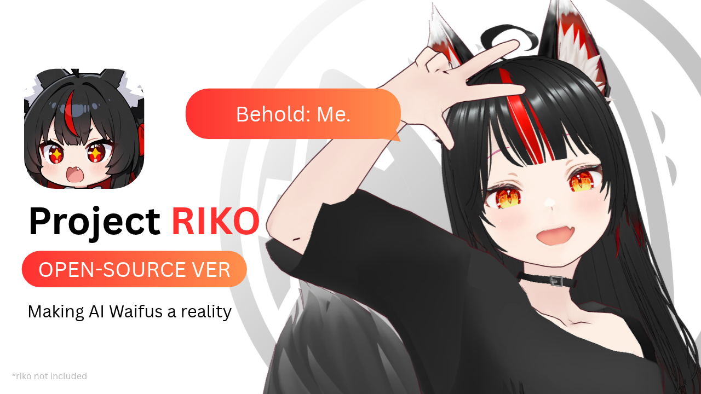
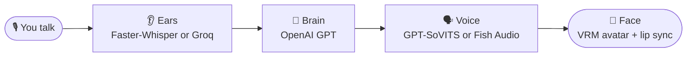

<picture>
  <source width="100%" srcset="./docs/banner-dark.png" media="(prefers-color-scheme: dark)" />
  <source width="100%" srcset="./docs/banner-light.png" media="(prefers-color-scheme: light), (prefers-color-scheme: no-preference)" />
  
</picture>

<h1 align="center">Project Vesper</h1>

<p align="center">
  <b>Talk to her out loud. She talks back.</b><br />
  An anime AI companion that runs on your own PC, with her own voice and a 3D avatar that lip-syncs every word.
</p>

> **Vesper model edition:** this copy uses Vesper's exported VRM. See [VESPER-MODEL.md](VESPER-MODEL.md) for the model path, setup steps, and backup location.

<p align="center">
  <a href="https://www.youtube.com/@JustRayen"></a>
  <a href="https://patreon.com/RayenAI"></a>
  <a href="https://discord.gg/rayenai"></a>
</p>
<p align="center">
  
  
  
  
  <a href="LICENSE"></a>
</p>

> [!IMPORTANT]
> **This is the 50K snapshot: a complete Vesper, open source and yours to keep.** It's frozen at this release, so it stays a stable base to build on.
>
> Vesper keeps growing on **[Patreon](https://patreon.com/RayenAI)**, home of the Full Source and the Desktop App. [See how they compare.](#three-ways)
>
> GitHub issues aren't monitored, so there's no support here.

## 🦊 Meet Vesper

Vesper is a voice companion you set up yourself. Press Enter and talk. She hears you, comes up with a reply (usually a snarky one), and says it out loud while her lips move along on screen.

This repo is the open-source core of Project Vesper: the whole loop from your voice to hers, written to be read. The browser studio includes the VRM viewer, chat, voice capture, settings and camera tools; the Python modules keep the model, speech recognition and voice generation in separate files.

Her personality, her avatar and her voice all live in one config file. Making her yours takes a few minutes.

## ✨ What she can do

| | |
|---|---|
| 🎙️ **Listens** | Push-to-talk, or type instead. Press Enter, speak, press Enter — or type a line and press Enter. |
| 👂 **Understands** | Speech to text with [Faster-Whisper](https://github.com/SYSTRAN/faster-whisper) on your own PC, or [Groq](https://console.groq.com)'s fast online Whisper. |
| 🧠 **Thinks** | Replies come from a local model through Ollama, or OpenAI GPT, in whatever personality you write for her. |
| 📝 **Keeps the conversation** | The chat is saved to `chat_history.json`, so she picks up where you left off. |
| 🗣️ **Speaks** | Clones a voice from a short clip with [GPT-SoVITS](https://github.com/RVC-Boss/GPT-SoVITS), or uses any voice on [Fish Audio](https://fish.audio/?fpr=rayen10). |
| 💃 **Shows up** | A VRM avatar in your browser that lip-syncs her vowel shapes, blinks, breathes and shifts her weight while idle. Her expression follows the line she is saying — a smile, a pout, a blush — and her eyes follow your cursor. Drag to spin her around, right-drag to move her, scroll to zoom. She also waves, bows, flinches when poked, and her body shifts with mood-driven gestures. |
| 🎭 **Becomes anyone** | Personality, avatar and voice are all set in one file. |
| 💬 **Browser chat** | Send messages in the avatar page, see saved conversation history, queue messages, or interrupt a reply. |
| 🎙️ **Browser voice** | Record a push-to-talk clip in the page, see its transcript, and send it to the configured speech recognizer. |
| 🧰 **Companion studio** | Style readable live captions, preview them, set size, contrast, position and hold time, and adjust chat text, timestamps, reduced motion and render quality. Captions light up word by word in time with her voice and also show what she heard you say. Search or copy replies, recover a local draft, reconnect the server, and control full screen, camera framing and avatar gestures. |
| ✨ **Shortcuts + secrets** | Use slash commands, keyboard shortcuts, a hidden dance, and the Konami moonlit theme. |
| 📤 **Take your work with you** | Export the conversation as JSON or save an avatar snapshot as PNG. |
| ✅ **Tells you what's missing** | Before she starts, a quick check catches a missing key, server or file and tells you how to fix it. |

## ⚙️ How it works



Each step is one file, and `main.py` runs them in a loop:

| Step | File | What it does |
|---|---|---|
| 👂 Ears | `vesper/asr.py` | Records you between the two Enters, turns it into text |
| 🧠 Brain | `vesper/llm.py` | Sends the chat to OpenAI, saves her answer to the history |
| 🗣️ Voice | `vesper/tts.py` | Turns her answer into a voice clip |
| 💃 Face | `vesper/viewer.py` + `client/index.html` | Plays the clip on the avatar page and moves her mouth with it |

## 🚀 Quick start

The easiest way in uses Fish Audio for her voice: no GPU and nothing extra to install. If you'd rather generate her voice on your own PC, do this first and then see [Local voice](#local-voice).

**You need:** a Windows or Linux PC, a microphone for voice input, a running [Ollama](https://ollama.com) model for local chat, and a [Fish Audio API key](https://fish.audio/?fpr=rayen10) for the default online voice. OpenAI and Groq keys are only needed if you choose those providers. The browser loads its pinned Three.js libraries from jsDelivr, so the first page load needs internet access.

**1. Install uv.** It sets up Python for you.

```powershell
# Windows (PowerShell)
powershell -ExecutionPolicy ByPass -c "irm https://astral.sh/uv/install.ps1 | iex"
```

```bash
# Linux
curl -LsSf https://astral.sh/uv/install.sh | sh
sudo apt install libportaudio2    # lets Python use your microphone
```

Close and reopen your terminal afterwards so it can find `uv`.

**2. Get the code.**

```bash
git clone https://github.com/rayenfeng/riko_project.git
cd vesper_project
```

No git? Click the green **Code** button at the top of this page → **Download ZIP**, unzip it, then open a terminal in that folder. On Windows 11: right-click inside the folder → **Open in Terminal**.

**3. Install everything.**

```bash
uv sync
```

**4. Add your API keys.**

```bash
copy .env.example .env    # Linux: cp .env.example .env
notepad .env              # Linux: nano .env
```

Paste your keys after the `=` signs and save. `.env` is git-ignored, so your keys stay out of any commit.

**5. Start her.**

```bash
uv run main.py --tts fish
```

The first launch takes a minute while it downloads the speech recognition model.

**6. Say hi.**

1. Vesper opens **http://127.0.0.1:8080**. Click the page once to enable browser audio.
2. Use the chat panel to type, or tap the microphone to record and send a voice message. Tap the microphone again to stop and submit.
3. Vesper answers on the page. Use the stop button to interrupt her, or **Ctrl+C** in the terminal to quit.

> [!TIP]
> Set `tts: fish` in `character_config.yaml` and a plain `uv run main.py` does the same thing.

> Use `/help` in chat for avatar commands. `/wave`, `/bow`, `/pose`, `/dance`, `/surprise`, `/shake`, `/spin`, `/recenter` and `/fullscreen` control the scene; `/secret` shows a small Easter egg. Keyboard: Enter sends, Shift+Enter adds a line, Ctrl+J toggles chat, C toggles captions, and 1–5 play gestures.

> [!NOTE]
> Her brain defaults to a local model: install [Ollama](https://ollama.com), run `ollama pull llama3.2` once, and leave the Ollama app running. No OpenAI key needed. Switch to `brain: openai` in `character_config.yaml` (plus `OPENAI_API_KEY` in `.env`) to use OpenAI instead.

## 🎨 Make her yours

Everything about her lives in `character_config.yaml`. Put her files (avatar, voice clip) in `character_files/`.

```yaml
system_prompt: |
  You are a helpful assistant named Vesper.
  You speak like a snarky anime girl.
  Always refer to the user as "senpai".
```

| To change her... | Edit |
|---|---|
| **Personality** | `system_prompt`. Describe her the way you'd brief an actor: who she is, how she talks, what she calls you. |
| **Look** | `vrm_model`. Any `.vrm` file works. You can make your own for free in [VRoid Studio](https://vroid.com/en/studio). |
| **Fish voice** | `fish.voice_id`. Open any voice on [fish.audio](https://fish.audio/?fpr=rayen10) and copy the ID from the page address: `fish.audio/m/<voice id>`. |
| **GPT-SoVITS voice** | `ref_audio_path`: a 3–10 second clip with no long silences. `prompt_text`: exactly what the clip says. |
| **Brain** | `brain: ollama` (a model on your PC, free and offline) or `brain: openai`. `model` is the name: `llama3.2` for Ollama, or any OpenAI model. |
| **Ears** | `asr: local` (Faster-Whisper, free, on your PC) or `asr: groq` (needs a free [Groq key](https://console.groq.com/keys)). |
| **Speech model size or GPU** | `WHISPER_MODEL` / `WHISPER_DEVICE` at the top of `vesper/asr.py`. |
| **A fresh start** | Delete `chat_history.json`. |

You can also switch voice or ears for one run without touching the config:

```bash
uv run main.py --tts sovits    # or fish
uv run main.py --asr groq      # or local
uv run main.py --brain openai  # or ollama
```

<a id="local-voice"></a>
## 🎤 Local voice with GPT-SoVITS

Want her voice generated on your own machine, cloned from any clip you like? That's what GPT-SoVITS does. It runs best on an NVIDIA GPU and is installed separately.

1. Install [GPT-SoVITS](https://github.com/RVC-Boss/GPT-SoVITS) by following its guide.
2. In the GPT-SoVITS folder, start its API server and leave it running:
   ```bash
   python api_v2.py -a 127.0.0.1 -p 9880
   ```
3. Start Vesper with `uv run main.py --tts sovits`.

She starts with the sample voice in `character_files/main_sample.wav`. Swap in your own clip (see the table above) to change it.

<a id="three-ways"></a>
## 💎 Three ways to have Vesper

Same Vesper, three ways to have her. Each one is made for a different kind of person, so pick the one that matches how you like to work.

| | 🛠️ Open Source<br /><sub>this repo</sub> | 🧪 [Full Source](https://patreon.com/RayenAI)<br /><sub>on Patreon</sub> | 🖥️ [Desktop App](https://patreon.com/RayenAI)<br /><sub>on Patreon</sub> |
|---|---|---|---|
| **Made for** | Builders who want a clean base to make their own | Tinkerers who want every new feature and the code behind it | Anyone who wants her up and running, no code involved |
| **What you get** | This repo: open source, under 500 lines | The full source of the newest build | A Windows app with an installer and a desktop icon |
| Talks with a lip-synced VRM avatar | ✅ | ✅ | ✅ |
| Hears you | Faster-Whisper on your PC, or Groq | Groq Whisper | Groq Whisper |
| Her voice | GPT-SoVITS voice clone or Fish Audio | GPT-SoVITS voice clone or Fish Audio | Both, switched in Settings, with automatic fallback |
| Conversation | Push-to-talk or typing, easy to rewire | Hands-free: she can tell when you've finished | Hands-free, or type to her |
| Face and body | Lip sync with vowel shapes, mood-driven expressions with blush, blinking, breathing and idle body motion, ready for your own animation system | Expressions and animations she picks herself | Expressions and animations she picks herself |
| Memory | Chat history in a file you control | Long-term memory across sessions | Long-term memory you can browse, edit and reset |
| Doing things | Plug in your own tools | Tool calling with tools you write | Looks things up online when you ask |
| Backgrounds and anime scenes | A clean stage for your own | Drop in any 3D room, with lighting presets and a light editor | A clean stage, all eyes on her |
| Your own character | Edit one config file: avatar, voice, personality | Edit the config files: avatar, voice, personality, room | Guided in the app: drop in a VRM, pick a voice, write her personality |
| VR and desktop window | Yours to add | Quest VR and a transparent floating window | Transparent floating window |
| Setup | `uv` and a terminal, with a setup checker | `setup.bat`, with a setup checker | One installer; keys tested on screen as you paste them |
| Runs on | Windows and Linux | Windows | Windows 10 / 11 |
| License | [MIT](LICENSE): fork it, change it, ship what you build | Personal use, full source included | Personal use; your videos and streams are yours |
| Updates | Stays at the 50K snapshot | New features as they land | Supported updates and bug fixes for version 1 |

<p align="center"><a href="https://patreon.com/RayenAI"><b>Get the Full Source or the Desktop App on Patreon →</b></a></p>

## 📋 Requirements

| | With Fish Audio (easiest) | With GPT-SoVITS (local voice) |
|---|---|---|
| **System** | Windows 10/11 or Linux | Windows 10/11 or Linux |
| **GPU** | Not needed | NVIDIA recommended |
| **Python** | 3.11+, installed by uv | 3.11+, installed by uv |
| **API keys** | OpenAI + Fish Audio | OpenAI |
| **Also** | Microphone, speakers or headphones, a browser with WebGL, an internet connection | Same, plus a working GPT-SoVITS install |

Tested on Windows 11 and Ubuntu 22.04 (WSL2) with an RTX 3060 12 GB. Faster-Whisper runs on the CPU, so any modern processor handles the ears.

**Where the keys come from**

| Key | When | Get it |
|---|---|---|
| `OPENAI_API_KEY` | `brain: openai` | [platform.openai.com](https://platform.openai.com/api-keys) |
| `FISH_API_KEY` | `tts: fish` | [fish.audio](https://fish.audio/?fpr=rayen10) |
| `GROQ_API_KEY` | `asr: groq` | [console.groq.com](https://console.groq.com/keys) (free tier) |

## 🆕 New in this release

| | |
|---|---|
| 🗣️ **Subtitles** | Her spoken lines appear as subtitles on the avatar page, with each word lighting up as the audio reaches it. Stage directions are stripped, pipelined sentences keep the caption steady, and your own voice messages get a caption while she listens. |
| 🔗 **Reads links** | Send her a URL and she opens the page, reads its text, and answers about it, or tells you plainly when it can't be read. Local and private addresses are refused. |
| ⏱️ **Bounded replies** | Only the recent conversation is sent to the model and each reply is capped, so a long chat or a rambling model can't spiral into an endless answer. |
| ⏸️ **Interrupt** | Press **Enter** while she talks to cut her off mid-sentence, then freely type a new message or press Enter again to talk hands-free. |
| 👂 **Hands-free listening** | She listens continuously; a pause in your speech auto-stops recording, so you don't need to press Enter each time. |
| 💾 **Memory** | She remembers your name and how many times you've talked together, and grows warmer over time. |
| 🎭 **Gestures** | She waves when she says hello, shakes when angry, bows when shy, flinches when poked, and her body shifts with mood (angry, smug, excited). |
| ❓ **Question prosody** | Her brows lift when her line contains a question mark. |

## 🩹 Troubleshooting

| You see | Try this |
|---|---|
| `[setup] OPENAI_API_KEY is missing` (or another key) | Add it to `.env`. Check the file is called exactly `.env`, not `.env.txt`. |
| `[setup] Ollama is not running` | Start the Ollama app (or `ollama serve`) and leave it running. |
| `[setup] Ollama does not have the model` | Pull it once: `ollama pull llama3.2`, or put a model you already have in `model` (`ollama list` shows them). |
| Replies hang for minutes, or every request sits in `thinking` | The local runner can wedge after repeated model reloads. Quit the Ollama app completely (or `taskkill /F /IM ollama.exe`), reopen it, then send again. |
| `GPT-SoVITS is not running` | Start its API server first (see [Local voice](#local-voice)), or run with `--tts fish`. |
| `Port 8080 is busy` | Vesper is probably already running in another terminal. Close that one. |
| `Avatar not found` | Check the `vrm_model` path in `character_config.yaml`. |
| She replies in the terminal, but there's no sound | Click the avatar page once. Browsers block sound until you do. |
| `no avatar page open, playing on speakers` | That's normal: with no page open she talks through your speakers. Open the page to see her. |
| She says a link couldn't be read | Some sites need JavaScript, a login, or block automated readers. Try the article's reader/print view or paste the text instead. |
| `(heard nothing, try again)` | Make sure your mic is the default recording device, and talk a little longer. |

## 🔧 Under the hood

```
main.py                the loop: record → transcribe → reply → speak → play
vesper/
  config.py            loads character_config.yaml and .env
  asr.py               push-to-talk recording + speech to text
  llm.py               OpenAI reply + chat_history.json
  tts.py               GPT-SoVITS or Fish Audio → client/audio/vesper.wav
  viewer.py            serves the avatar page and hands it each voice clip
client/
  index.html           three.js + three-vrm: the avatar, expressions, lip sync, blinking, idle motion, rotate and zoom
character_files/       her avatar (sample_avatar.vrm) and sample voice (main_sample.wav)
character_config.yaml  her personality, avatar and voice
```

Every part also runs on its own, which helps when something isn't working:

```bash
uv run python -m vesper.llm      # one reply from OpenAI
uv run python -m vesper.tts      # one voice line (add --fish for Fish Audio)
uv run python -m vesper.asr      # record, then print what she heard
```

**Ideas if you want to build on it**

- **Hands-free listening.** Replace `_record()` in `vesper/asr.py` with something that notices when you stop talking.
- **Emotions.** `vesper/llm.py` picks a mood from her reply (`mood()`), and `MOODS` in `client/index.html` turns it into expression weights — add a row to both and she has a new feeling. `client/index.html` drives her mouth with `vrm.expressionManager.setValue('aa' | 'ih' | 'ou', ...)` too. Add motion in `animate(dt)` — it runs every frame with her bone rig, and anything a model does not have is skipped.
- **Gestures.** `vesper/tts.py` knows when she is talking; a line in `viewer.py` could tell the page to wave instead of just nod.

## 🙏 Credits

- Voice by [GPT-SoVITS](https://github.com/RVC-Boss/GPT-SoVITS) and [Fish Audio](https://fish.audio/?fpr=rayen10)
- Speech recognition by [Faster-Whisper](https://github.com/SYSTRAN/faster-whisper) and [Groq](https://groq.com)
- Language model by [OpenAI](https://platform.openai.com)
- Avatar rendering by [three.js](https://threejs.org) and [three-vrm](https://github.com/pixiv/three-vrm)
- Sample avatar by [pixiv Inc.](https://github.com/pixiv/three-vrm) (VRM1_Constraint_Twist_Sample)

## 📄 License

[MIT](LICENSE). Feel free to clone, modify, and build your own waifu voice companion.
